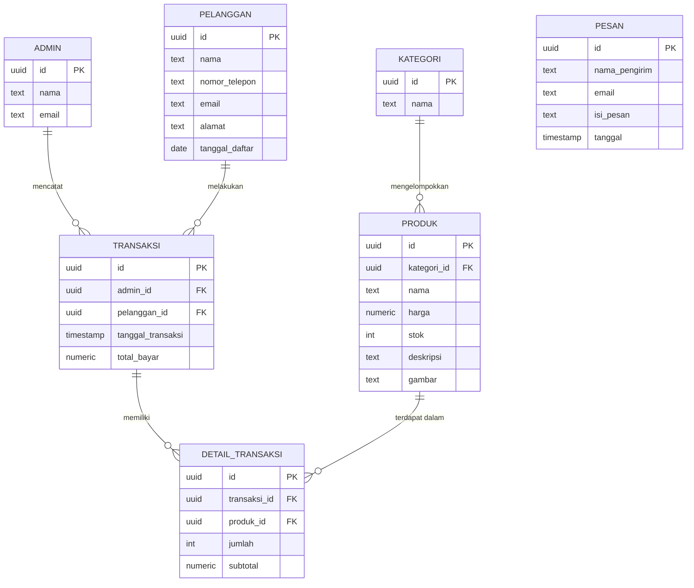

# PROJECT_CONTEXT.md — Website Sistem Manajemen Pelanggan & Transaksi Penjualan Toko Pandu

> File ini adalah **sumber kebenaran (single source of truth)** untuk proyek.
> Baca seluruh file ini sebelum membuat wireframe, desain, atau kode apa pun.
> Jangan menambah fitur di luar yang tertulis di sini. Jika ada hal yang tidak jelas, tulis sebagai asumsi di akhir hasil kerja, jangan mengarang fitur baru.

---

## 1. Ringkasan Proyek

| Item | Isi |
|---|---|
| Judul | Rancang Bangun Website Sistem Manajemen Pelanggan dan Transaksi Penjualan pada Toko Pandu Menggunakan Metode Rapid Application Development (RAD) |
| Jenis | Tugas Akhir, Program Studi Sistem Informasi, Primakara University |
| Klien | Toko Pandu, toko ritel yang menjual barang kebutuhan umum |
| Alamat toko | Jl. Raya Bumbak Gg. Pulau 71, Kerobokan, Kec. Kuta Utara, Kabupaten Badung, Bali 80361 |
| Bahasa antarmuka | **Bahasa Indonesia** (semua label, menu, pesan error, dan placeholder) |
| Metode | RAD: Requirements Planning, User Design, Construction, Cutover |
| Tahap saat ini | **User Design**: membuat wireframe dan prototipe tampilan |

### Masalah yang diselesaikan
Pencatatan data pelanggan dan transaksi masih manual dan terpisah, riwayat belanja sulit dilacak, dan laporan penjualan lambat disusun.

### Tujuan sistem
1. Mengelola data pelanggan secara terpusat (CRM sederhana).
2. Mencatat transaksi penjualan dan memperbarui stok otomatis.
3. Menyediakan riwayat belanja pelanggan.
4. Menghasilkan laporan penjualan harian dan bulanan.
5. Menyediakan website informasi toko (beranda, katalog, kontak) untuk pengunjung.

---

## 2. Batasan Penting (Scope Guard)

- Ini **BUKAN e-commerce**. **Tidak ada** keranjang, checkout, atau pembayaran online.
- Katalog produk bersifat **informasi saja** (nama, kategori, harga, stok, gambar).
- Transaksi penjualan **hanya dicatat oleh Admin** (penjualan di toko fisik).
- Pelanggan hanya bisa: melihat halaman publik, mendaftar, login, melihat profil dan riwayat belanja, serta mengirim pertanyaan lewat formulir kontak.
- Hanya ada **2 peran**: `Pelanggan` dan `Admin`. Tidak ada peran kasir, owner, atau lainnya.
- Pengunjung tanpa login boleh mengakses halaman publik dan mengirim formulir kontak.

---

## 3. Teknologi

| Lapisan | Teknologi |
|---|---|
| Framework | Next.js (App Router) + React |
| Styling | Tailwind CSS |
| Backend & DB | Supabase (PostgreSQL, Auth, Storage untuk gambar produk) |
| Desain | Figma (wireframe/prototipe), Visual Studio Code |
| Version control | Git & GitHub |
| Pengujian | Black Box Testing |

---

## 4. Aktor dan Hak Akses

| Aktor | Login? | Akses |
|---|---|---|
| Pengunjung | Tidak | Beranda, Katalog Produk, Kontak & Lokasi, kirim pertanyaan, halaman Daftar |
| Pelanggan | Ya | Semua akses pengunjung, Profil, Riwayat Belanja |
| Admin | Ya (wajib) | Dashboard, Kelola Pelanggan, Kelola Produk, Transaksi, Laporan, Logout |

Setelah login, sistem mengarahkan pengguna sesuai perannya: **Admin → `/admin`**, **Pelanggan → `/profil`**.

---

## 5. Kebutuhan Fungsional

| ID | Kebutuhan |
|---|---|
| FR-01 | Halaman Beranda: informasi umum dan produk unggulan Toko Pandu |
| FR-02 | Halaman Katalog Produk: daftar produk beserta kategori, harga, dan ketersediaan stok |
| FR-03 | Pendaftaran pelanggan untuk mencatat identitas |
| FR-04 | Halaman profil pelanggan: data diri dan riwayat belanja |
| FR-05 | Halaman Kontak & Lokasi: alamat, peta, formulir pertanyaan |
| FR-06 | Menu navigasi untuk berpindah antar halaman |
| FR-07 | Halaman login untuk autentikasi sebelum mengakses fitur terbatas |
| FR-08 | Dashboard admin: ringkasan data pelanggan dan penjualan |
| FR-09 | Admin mengelola data pelanggan (tambah, ubah, hapus, cari) |
| FR-10 | Admin mengelola data produk beserta kategori dan stok (tambah, ubah, hapus) |
| FR-11 | Admin mencatat transaksi penjualan dan melihat riwayat transaksi |
| FR-12 | Laporan penjualan harian dan bulanan untuk admin |
| FR-13 | Fitur logout |

## 6. Kebutuhan Non-Fungsional

- Antarmuka sederhana, ramah pengguna, dan **konsisten**.
- Berjalan lancar di Chrome, Firefox, dan Edge.
- Waktu respons cepat dan stabil.
- **Responsive design**: optimal di layar komputer dan smartphone (mobile-first).
- Autentikasi dan otorisasi aman untuk panel admin; data pelanggan terlindungi.

---

## 7. Peta Halaman (Sitemap)

### Area publik
| Rute | Halaman | FR |
|---|---|---|
| `/` | Beranda | FR-01, FR-06 |
| `/katalog` | Katalog Produk (filter kategori, pencarian) | FR-02 |
| `/kontak` | Kontak & Lokasi (alamat, peta, formulir pertanyaan) | FR-05 |
| `/daftar` | Pendaftaran Pelanggan | FR-03 |
| `/login` | Login (dipakai Admin dan Pelanggan) | FR-07 |
| `/profil` | Profil & Riwayat Belanja (khusus Pelanggan login) | FR-04 |

### Panel Admin (semua wajib login Admin)
| Rute | Halaman | FR |
|---|---|---|
| `/admin` | Dashboard | FR-08 |
| `/admin/pelanggan` | Daftar Pelanggan (cari, tambah, ubah, hapus) | FR-09 |
| `/admin/produk` | Daftar Produk dan Kategori (tambah, ubah, hapus) | FR-10 |
| `/admin/transaksi` | Riwayat Transaksi | FR-11 |
| `/admin/transaksi/baru` | Form Transaksi Baru | FR-11 |
| `/admin/laporan` | Laporan Penjualan (harian/bulanan) | FR-12 |
| Tombol Logout | Di sidebar/header admin | FR-13 |

> Opsional (tidak ada di laporan, hanya jika diminta): `/admin/pesan` untuk membaca pesan dari formulir kontak. Entitas `Pesan` ada di database.

---

## 8. Alur Proses (Activity Diagram)

Legenda: **[A]** aksi Admin/Pelanggan, **[S]** aksi Sistem.

### 8.1 Autentikasi (Gambar 2.2)
1. [A] Membuka halaman login → memasukkan email dan kata sandi.
2. [S] Validasi kredensial via Supabase Auth.
3. Jika **tidak valid**: [S] tampilkan pesan kesalahan, kembali ke langkah 1.
4. Jika **valid**: [S] buat sesi login → cek peran → arahkan ke dashboard (Admin) atau profil (Pelanggan).

### 8.2 Kelola Data Pelanggan (Gambar 2.3)
1. [A] Buka menu Pelanggan → [S] tampilkan daftar pelanggan.
2. [A] Pilih aksi:
   - **Cari**: masukkan kata kunci → [S] tampilkan hasil.
   - **Tambah/Ubah**: isi formulir (nama, telepon, email, alamat) → [S] validasi; jika tidak valid tampilkan error dan kembali ke formulir; jika valid simpan ke database.
   - **Hapus**: pilih data → [S] tampilkan dialog konfirmasi → jika dikonfirmasi hapus data, jika tidak batal.
3. [S] Tampilkan daftar pelanggan terbaru.

### 8.3 Kelola Transaksi Penjualan (Gambar 2.4)
1. [A] Buka menu Transaksi → [S] tampilkan formulir transaksi.
2. [A] Pilih pelanggan.
3. [A] Pilih produk dan isi jumlah beli → [S] cek stok; jika tidak cukup tampilkan pesan dan kembali memilih produk.
4. [S] Hitung subtotal dan total otomatis.
5. [A] Tambah produk lain? Ya: ulangi langkah 3. Tidak: lanjut.
6. [S] Simpan transaksi dan detail transaksi → kurangi stok produk → catat di riwayat belanja pelanggan → tampilkan konfirmasi berhasil.

### 8.4 Laporan Penjualan (Gambar 2.5)
1. [A] Buka menu Laporan → [S] tampilkan pilihan periode.
2. [A] Pilih periode: **Harian** (pilih tanggal) atau **Bulanan** (pilih bulan).
3. [S] Ambil data transaksi pada periode → hitung jumlah transaksi dan total penjualan → tampilkan rekapitulasi.

### 8.5 Pendaftaran dan Riwayat Belanja Pelanggan (Gambar 2.6)
1. [A] Buka halaman pendaftaran → isi data diri (nama, telepon, email, alamat, kata sandi).
2. [S] Validasi; jika tidak valid tampilkan error dan kembali ke formulir; jika valid simpan data pelanggan.
3. [A] Login → [S] validasi dan buat sesi.
4. [A] Buka halaman profil → [S] tampilkan data diri dan daftar riwayat transaksi.

---

## 9. Model Data (ERD, Gambar 2.7)



Catatan model data:
- Relasi: satu Admin → banyak Transaksi; satu Pelanggan → banyak Transaksi; satu Transaksi → banyak Detail Transaksi; satu Produk → banyak Detail Transaksi; satu Kategori → banyak Produk.
- `Pesan` berdiri sendiri (diisi pengunjung lewat formulir kontak, tanpa login).
- Tipe data dan nama kolom foreign key adalah usulan implementasi. Sesuaikan dengan skema Supabase final.
- Aturan bisnis: `subtotal = harga × jumlah`; `total_bayar = jumlah seluruh subtotal`; stok produk berkurang sesuai `jumlah` saat transaksi tersimpan; jumlah beli tidak boleh melebihi stok.

---

## 10. Detail Isi Tiap Halaman

**Beranda**: hero (nama toko, tagline singkat, tombol "Lihat Katalog"), profil singkat toko, produk unggulan/promo, ajakan mendaftar, footer (alamat, jam buka, kontak).

**Katalog Produk**: grid kartu produk (gambar, nama, kategori, harga dalam Rupiah, badge stok: Tersedia / Menipis / Habis), filter kategori, kolom pencarian. Tanpa tombol beli/keranjang.

**Kontak & Lokasi**: alamat lengkap, peta (embed), formulir pertanyaan (nama, email, isi pesan), tombol kirim, pesan sukses.

**Daftar**: formulir (nama, nomor telepon, email, alamat, kata sandi, konfirmasi kata sandi), validasi inline, tautan ke Login.

**Login**: email, kata sandi, tombol masuk, pesan error, tautan ke Daftar.

**Profil Pelanggan**: kartu data diri (nama, telepon, email, alamat, tanggal daftar) dan tabel riwayat belanja (tanggal, daftar produk, total bayar), dengan detail transaksi yang bisa dibuka.

**Dashboard Admin**: kartu ringkasan (total pelanggan, total produk, jumlah transaksi hari ini, total penjualan hari ini/bulan ini), grafik penjualan sederhana, daftar transaksi terbaru, peringatan stok menipis.

**Kelola Pelanggan**: tabel + pencarian + tombol Tambah; aksi Ubah/Hapus per baris; formulir dalam modal atau halaman; dialog konfirmasi hapus.

**Kelola Produk**: tabel + pencarian + filter kategori; tambah/ubah/hapus (nama, kategori, harga, stok, deskripsi, unggah gambar); kelola kategori.

**Transaksi Baru**: pilih pelanggan (dropdown dengan pencarian), tabel item (produk, harga, jumlah, subtotal, hapus), tombol tambah produk, total otomatis, tombol Simpan Transaksi, pesan "stok tidak mencukupi".

**Riwayat Transaksi**: tabel (tanggal, pelanggan, total) dengan detail item.

**Laporan Penjualan**: toggle Harian/Bulanan, pemilih tanggal/bulan, ringkasan (jumlah transaksi, total penjualan), tabel transaksi pada periode.

---

## 11. Panduan Desain

- **Gaya**: bersih, sederhana, profesional, cocok untuk toko ritel lokal. Mudah dipakai oleh pemilik toko yang tidak terlalu teknis.
- **Mobile-first**, breakpoint Tailwind standar. Navigasi publik: navbar atas (hamburger di mobile). Panel admin: sidebar (drawer di mobile) + header.
- Satu sistem desain konsisten: warna utama + 1 warna aksen + netral, 1 keluarga font, radius dan bayangan seragam.
- **Palet warna belum ditentukan klien.** Usulkan 1 palet (hex lengkap) di awal hasil kerja, simpan sebagai token di `tailwind.config` dan CSS variables.
- Format Rupiah: `Rp 25.000`. Format tanggal Indonesia: `15 Oktober 2026`.
- Setiap halaman data wajib punya state: **loading, kosong (empty), error, sukses**.
- Form: label jelas, validasi inline berbahasa Indonesia, tombol utama menonjol, tombol destruktif (hapus) berwarna berbeda dan selalu dengan konfirmasi.
- Aksesibilitas dasar: kontras cukup, fokus terlihat, ukuran target sentuh minimal 44px, atribut `alt` pada gambar.
- Gambar produk memakai placeholder bila belum ada.

---

## 12. Struktur Proyek yang Disarankan

```
toko-pandu/
├─ app/
│  ├─ (publik)/        # /, /katalog, /kontak, /daftar, /login
│  ├─ (pelanggan)/     # /profil
│  └─ admin/           # /admin, /pelanggan, /produk, /transaksi, /laporan
├─ components/
│  ├─ ui/              # Button, Input, Modal, Table, Badge, Card, dll.
│  ├─ layout/          # Navbar, Footer, AdminSidebar, AdminHeader
│  └─ fitur/           # ProdukCard, TransaksiForm, LaporanTable, dll.
├─ lib/
│  ├─ supabase/        # client, server, middleware
│  ├─ mock-data.ts     # data dummy selama tahap UI
│  └─ format.ts        # formatRupiah, formatTanggal
├─ types/              # tipe TypeScript sesuai ERD
└─ middleware.ts       # proteksi rute /admin dan /profil
```

---

## 13. Urutan Pengerjaan (RAD)

1. **Wireframe** low-fidelity semua halaman (desktop dan mobile), ditinjau bersama pemilik toko.
2. **Tampilan website** (UI) dengan data dummy.
3. Integrasi Supabase: skema tabel, Auth, Row Level Security, Storage.
4. Menghubungkan UI ke data nyata (construction).
5. Black Box Testing, deployment, demo, serah terima (cutover).

---

## 14. Daftar Gambar di Laporan (referensi)

Gambar 2.1 Use Case · 2.2 Activity Autentikasi · 2.3 Activity Data Pelanggan · 2.4 Activity Transaksi · 2.5 Activity Laporan · 2.6 Activity Pendaftaran & Riwayat · 2.7 ERD.
Semua diagram tersedia sebagai PNG di folder `docs/diagram/` (jika disertakan).
